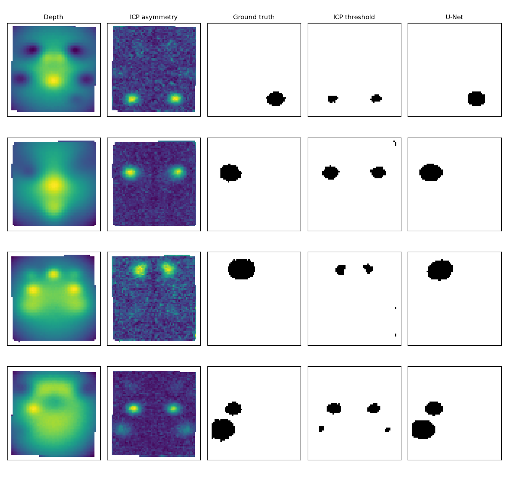

# asymmetry-unet

[](../../actions/workflows/ci.yml)

Locating the asymmetric regions of a 3D surface: a classical symmetry-plane ICP baseline, a
U-Net that learns which side is actually deformed, and the U-Net exported to ONNX and
quantized to INT8 for CPU inference.



*Test samples. Columns: depth map, ICP asymmetry map, ground truth, thresholded ICP map,
U-Net prediction.*

## Problem

A symmetry-plane method measures, for each point, how far its mirror image lies from the
surface. That map shows *that* a surface is asymmetric, but not *where* the deformation is:
a bump on the left also lights up the mirrored region on the right, which is perfectly
normal. Thresholding the map therefore marks both sides (third and fourth columns above).

## Approach

1. **Symmetry plane by ICP** (`icp.py`), ported from a MATLAB implementation: reflect the cloud
   across the current plane, match each reflected point to its nearest neighbour (KD-tree),
   update the plane in closed form (eigenvector of the smallest eigenvalue). The port gives
   the same plane, iteration count and asymmetry as the MATLAB code on the original datasets.
2. **Initialisation fix.** The original code starts from the principal axis of smallest
   variance. On a face-like surface that axis is the depth direction, and ICP settles on a
   wrong plane: on a perfectly symmetric face scan it reported a mean asymmetry of 7.15 (in
   data units) without converging in 60 iterations. Starting from the three principal axes
   and keeping the best plane finds the right one in 2 iterations, with a mean asymmetry of
   0.026 (about 275 times lower).
3. **Synthetic data with exact ground truth** (`synth.py`): smooth height fields exactly
   symmetric about a plane, one or two local bumps or dents added on one side (85 % of
   samples; the others stay symmetric), sensor noise, random rigid motion. The deformed points
   are known exactly. Everything is generated from seeds, so the dataset is fully
   reproducible.
4. **Rendering** (`render.py`): the plane estimated by ICP defines a canonical frame; depth,
   ICP asymmetry and validity are interpolated on a 64 x 64 grid.
5. **U-Net** (`model.py`, 483 k parameters) on those three maps, trained with BCE + soft Dice
   on 4,000 samples, model selected on 500 validation samples, evaluated on 1,000 test samples
   with disjoint seeds.
6. **ONNX export and static INT8 quantization** (`export.py`, ONNX Runtime, QDQ format,
   per-channel weights, 200 calibration samples), compared with FP32 on CPU.

## Results

Test set, 1,000 samples (`results/`). Dice and IoU are averaged per image; an empty
prediction of a symmetric sample counts as a perfect score.

| Method | Dice | IoU | Dice (deformed samples) | False alarms on symmetric samples |
| --- | ---: | ---: | ---: | ---: |
| ICP asymmetry map, threshold tuned on validation | 0.43 | 0.31 | 0.41 | 50 % |
| **U-Net** | **0.90** | **0.85** | **0.88** | 0.7 % |

The ICP plane itself is accurate (median error 0.8 degrees on the test set): the gap comes
from the mirror ambiguity, which the U-Net resolves by using the depth map as well.

| U-Net on CPU (ONNX Runtime, 1 thread, batch 1) | Dice | File size | Median latency |
| --- | ---: | ---: | ---: |
| FP32 | 0.900 | 1.9 MB | 1.19 ms |
| **INT8** | **0.901** | **0.5 MB** | **0.64 ms** |

The FP32 ONNX model matches PyTorch to 2e-5. INT8 quantization makes the model 3.7 times
smaller and 1.9 times faster with no loss of accuracy on this task. Training took 64 s on one
RTX 5070 Ti.

## Run

```bash
python -m venv .venv && . .venv/bin/activate
pip install -e ".[dev]"
python -m asymunet all --out runs/v1   # data (~2 min, 8 processes), training, ONNX export
pytest
```

`python -m asymunet data|train|export` runs one step. Data goes to `data/`, models and result
files to `runs/v1/`.

## Limitations

- **Synthetic surfaces.** The surfaces are smooth height fields with Gaussian deformations.
  Real scans (faces, brain structures) have holes, outliers and natural asymmetries that this
  benchmark does not model; the U-Net has not been evaluated on them.
- **One training run.** The figures come from a single seed; the variance across training
  runs has not been measured.
- **Simple baseline.** The ICP baseline is a global threshold of the asymmetry map. A
  smarter baseline (e.g. choosing the side with a local surface prior) would close part of
  the gap.

## Licence

MIT.
