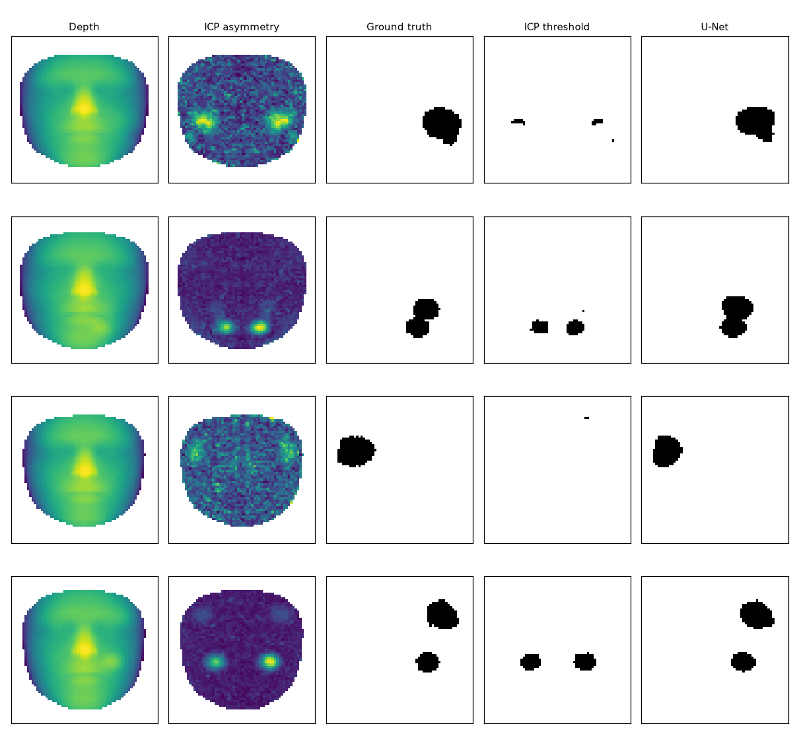

# asymmetry-unet

[](../../actions/workflows/ci.yml)

Extension of an ESIR course project on 3D asymmetry detection (faces, brain ventricles).

Locating the asymmetric regions of a 3D surface: a classical symmetry-plane ICP baseline, a
U-Net that learns which side is actually deformed, and the U-Net exported to ONNX and
quantized to INT8 for CPU inference.



*Test faces. Columns: depth map, ICP asymmetry map, ground truth, thresholded ICP map, U-Net
prediction. The thresholded map marks each deformation and its mirror; the U-Net finds the
deformed side.*

## Problem

A symmetry-plane method measures, for each point, how far its mirror image lies from the
surface. That map shows *that* a surface is asymmetric, but not *where* the deformation is:
a bump on the left also lights up the mirrored region on the right, which is perfectly
normal. Thresholding the map therefore marks both sides (third and fourth columns above).

## Approach

1. **Symmetry plane by ICP** (`icp.py`), ported from a MATLAB implementation: reflect the cloud
   across the current plane, match each reflected point to its nearest neighbour (KD-tree),
   update the plane in closed form (eigenvector of the smallest eigenvalue). Run from the
   same initialisation, the port gives the same plane, iteration count and asymmetry as the
   MATLAB code on the course datasets.
2. **Initialisation.** ICP only reaches the right plane from a reasonable start. A first
   draft of the MATLAB code started from the principal axis of smallest variance, which on a
   face-like surface is the depth direction: on a perfectly symmetric face it settled on a
   wrong plane. The final version of the course project chose the principal axis best
   aligned with the symmetry axis. The port starts from each of the three principal axes and
   keeps the plane of lowest mean asymmetry, which needs no prior knowledge of that axis and
   finds the right plane in 2 iterations on the symmetric face.
3. **Synthetic data with exact ground truth** (`synth.py`, `face.py`), on two kinds of
   surfaces: smooth height fields, and faces built from MediaPipe's canonical face mesh
   (Apache 2.0, a generic face, not a real person) with random symmetric changes of
   proportions and morphology. Both are exactly symmetric about a plane, then get
   one or two local bumps or dents on one side (85 % of
   samples; the others stay symmetric), sensor noise, random rigid motion. The deformed points
   are known exactly. Everything is generated from seeds, so the dataset is fully
   reproducible.
4. **Rendering** (`render.py`): the plane estimated by ICP defines a canonical frame; depth,
   ICP asymmetry and validity are interpolated on a 64 x 64 grid.
5. **U-Net** (`model.py`, 483 k parameters) on those three maps, trained with BCE + soft Dice
   on 4,000 samples, model selected on 500 validation samples, evaluated on 1,000 test samples
   with disjoint seeds.
6. **ONNX export and static INT8 quantization** (`export.py`, ONNX Runtime, QDQ format,
   per-channel weights, 200 calibration samples), compared with FP32 on CPU.

## Results

Test set, 1,000 samples (`results/`). Dice and IoU are averaged per image; an empty
prediction of a symmetric sample counts as a perfect score.

| Method | Dice | IoU | Dice (deformed samples) | False alarms on symmetric samples |
| --- | ---: | ---: | ---: | ---: |
| ICP asymmetry map, threshold tuned on validation | 0.43 | 0.31 | 0.41 | 50 % |
| **U-Net** | **0.90** | **0.85** | **0.88** | 0.7 % |

The two methods answer different questions. The ICP plane itself is accurate (median error
0.8 degrees on the test set) and the asymmetry map correctly shows *how much* the surface
departs from its mirror image. What it cannot show is *which side* is deformed: thresholding it
marks the deformation and its mirror, so even a perfect map would score a Dice of 2/3 at best on
this task. The U-Net takes that map as input, together with the depth, and learns from labelled
examples which of the two regions is the deformation.

**Faces** (1,000 test faces, same protocol):

| Method | Dice | Dice (deformed samples) | False alarms on symmetric faces |
| --- | ---: | ---: | ---: |
| ICP asymmetry map, threshold tuned on validation | 0.41 | 0.36 | 25 % |
| U-Net trained on height fields only (never saw a face) | 0.74 | 0.69 | 0.7 % |
| **U-Net trained on faces** | **0.88** | **0.86** | **0 %** |

The model trained on abstract surfaces already beats the baseline on faces it has never
seen; training on faces adds 0.14 Dice, which is the cost of the domain shift.

| U-Net on CPU (ONNX Runtime, 1 thread, batch 1) | Dice | File size | Median latency |
| --- | ---: | ---: | ---: |
| FP32 (height fields) | 0.900 | 1.9 MB | 1.19 ms |
| **INT8** (height fields) | **0.901** | **0.5 MB** | **0.64 ms** |
| FP32 (faces) | 0.877 | 1.9 MB | 1.16 ms |
| **INT8** (faces) | **0.877** | **0.5 MB** | **0.62 ms** |

The FP32 ONNX model matches PyTorch to 2e-5. INT8 quantization makes the model 3.7 times
smaller and 1.9 times faster with no loss of accuracy on this task. Training took 64 s on one
RTX 5070 Ti.

## Run

```bash
python -m venv .venv && . .venv/bin/activate
pip install -e ".[dev]"
python -m asymunet all --out runs/v1   # height fields: data (~2 min), training, ONNX export
python -m asymunet all --base face --data data_face --out runs/face   # faces (~6 min of data)
python -m asymunet eval-on --out runs/v1 --data data_face             # height-field model on faces
pytest
```

`python -m asymunet data|train|export` runs one step. Data goes to `data/`, models and result
files to `runs/v1/`.

## Limitations

- **Synthetic surfaces.** Height fields and a generic face mesh with Gaussian deformations.
  Real scans (faces, brain structures) have holes, outliers and natural asymmetries that this
  benchmark does not model, and the U-Net has not been evaluated on them: the scans used in
  the course are research data that cannot be redistributed.
- **One training run.** The figures come from a single seed; the variance across training
  runs has not been measured.
- **Simple baseline.** The ICP baseline is a global threshold of the asymmetry map. A
  smarter baseline (e.g. choosing the side with a local surface prior) would close part of
  the gap.

## Licence

MIT.
